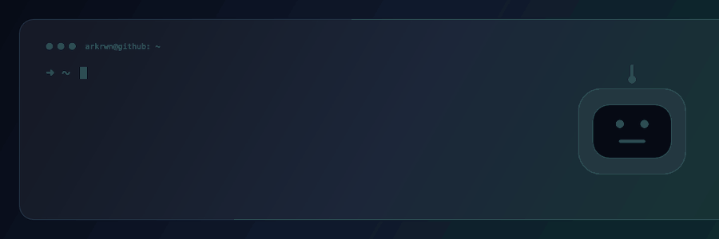
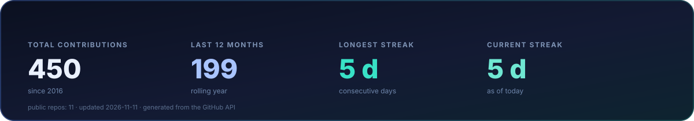

  

 

  
  
  

---

### 🧠 A Tiny Intro

  

---

### ⚙️ What I Actually Do

<table>
<tr>
<td width="33%" valign="top">

**🔍 Offensive Security**

pentest, vulnerability assessment, and proof-of-concepts that show the real impact - not just a scanner screenshot.

</td>
<td width="33%" valign="top">

**🛡️ DevSecOps**

shifting security left without slowing people down: pipelines, scanners, guardrails, and sane defaults.

</td>
<td width="33%" valign="top">

**🧱 Engineering**

python & bash tooling, linux administration, code review, and automating the boring parts of security work.

</td>
</tr>
</table>

---

### 🛠️ Toolbox

  

  
  
  
  
  
  

---

### 🛰️ A Few Corners of My Workshop

| Project | What It Is | Stack |
|---|---|---|
| **[memoryos](https://github.com/arkrwn/memoryos)** | Rust workspace kept in sync with upstream | `rust` |
| **[mikavt](https://github.com/arkrwn/mikavt)** | small Rust tool, still growing | `rust` |
| **[FullstakFastAPI](https://github.com/arkrwn/FullstakFastAPI)** | FastAPI + admin panel + MongoDB starter | `python` `mongo` |
| **[django-DefectDojo](https://github.com/arkrwn/django-DefectDojo)** | vulnerability management platform, synced with `DefectDojo/django-DefectDojo` | `python` |
| **arkrwn-scripts** *(private)* | my toolbox: secret scanners, PoC collection, small utilities | `python` `bash` |
| **ejentiks** *(private)* | private Rust project, in progress | `rust` |

Some things stay private - happy to talk about them over tea.

---

### 📈 The Numbers

  

  <picture>
    <source media="(prefers-color-scheme: dark)" srcset="https://github-profile-summary-cards.vercel.app/api/cards/most-commit-language?username=arkrwn&theme=github_dark" />
    
  </picture>
  <picture>
    <source media="(prefers-color-scheme: dark)" srcset="https://github-profile-summary-cards.vercel.app/api/cards/repos-per-language?username=arkrwn&theme=github_dark" />
    
  </picture>

  

---

### 📡 Say Hi

  
  
  

If you're working on **security tooling, devsecops, or open-source offensive security** - my inbox is open. I answer faster than most scanners.
