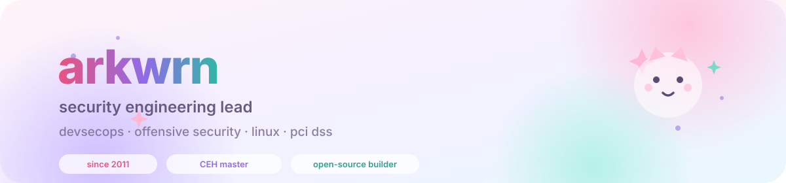
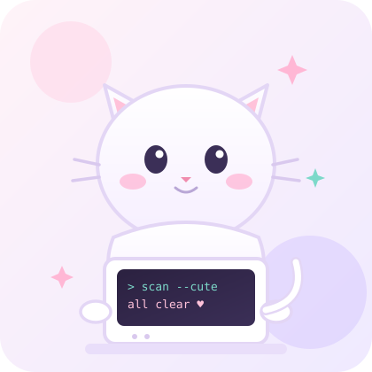

  

  
  
  

  

<table>
<tr>
<td width="58%" valign="top">

### 🌷 a tiny intro

I'm a **Security Engineering Lead** who has been poking at systems since 2011 — professionally in sysadmin & security engineering since 2015, and now living in the space between *shipping fast* and *sleeping well at night*.

I write scripts to make my own life easier, then turn them into tools other people can use. Most of my work happens in terminals, on Linux, around CI pipelines and whatever is on fire that week.

- 🔭 currently — devsecops, security management, and a lot of code review
- 🧪 tinkering with — Rust, Python, Go, and small offensive tooling
- 🎓 CEH Master (ANSI + Practical) · AWS Academy Cloud Foundations
- 🫶 community — IDFA member since 2015 · ID-LUG Jakarta 2014–2017
- ☕ fuel — black coffee and unreasonably long `git log` sessions

</td>
<td width="42%" align="center">
  
</td>
</tr>
</table>

---

### 🧰 toolbox

  

  
  
  
  
  
  

---

### ✨ what I actually do

<table>
<tr>
<td width="33%" valign="top">

**🔍 offensive security**

penetration testing, vulnerability assessment, exploit validation, and writing PoCs that actually prove the point.

</td>
<td width="33%" valign="top">

**🛡️ devsecops**

shifting security left without making developers miserable — pipelines, scanners, guardrails, and sane defaults.

</td>
<td width="33%" valign="top">

**⚙️ engineering**

python & bash tooling, linux administration, code review, and automating the boring parts of security work.

</td>
</tr>
</table>

---

### 🌸 a few corners of my workshop

| project | what it is | stack |
|---|---|---|
| **[mikavt](https://github.com/arkrwn/mikavt)** | a small Rust experiment, growing in public | `rust` |
| **[Pahawang-Island-Data](https://github.com/arkrwn/Pahawang-Island-Data)** | open data + microsite for Pahawang Island | `html` |
| **[FullstakFastAPI](https://github.com/arkrwn/FullstakFastAPI)** | FastAPI + admin panel + MongoDB starter | `python` `mongo` |
| **[geojson2shp](https://github.com/arkrwn/geojson2shp)** | geojson → shapefile converter, kept in sync with upstream | `python` |
| **arkrwn-scripts** *(private)* | my toolbox: secret scanners, PoC collection, tiny utilities | `python` `bash` |

Most of the good stuff lives in private repos — happy to talk about it over coffee.

---

### 📊 the numbers

  

  
  

  

  

---

### 📮 say hi

  
  

If you're working on something around **security tooling, devsecops, or open-source offensive security** — my inbox is open. I answer faster than most scanners.

  
  made with ☕, too many terminals, and a suspicious amount of pink

